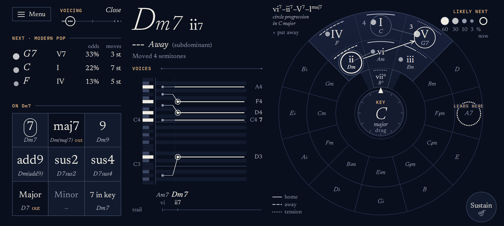

# Almagest

A chord instrument for your phone, drawn as a star chart of the circle of fifths. You play chords on the circle, and it shows you why harmony moves while you play: which chords belong to the key, which ones usually come next, and how each voice gets from one chord to the next.



**Play it:** [almagest.andrewrausch.com](https://almagest.andrewrausch.com). It's made for an Android phone held sideways; add it to your home screen to install it.

The name comes from Ptolemy's star catalog. The same Ptolemy also wrote the *Harmonics*.

## What it does

- **The circle is the keyboard.** Twelve columns of major, minor and diminished chords. Touch one to play it. The key's seven chords form a lit region of sky, each marked with its Roman numeral and its function: home, away or tension.
- **The chords likely to come next are stars.** Hold a chord and the chords that usually follow it light up, brighter for more likely, with the odds in a table. The odds are counted from real music, and you can switch between three collections: modern pop, classic pop and jazz.
- **You can see the voice leading.** A note shared by two chords keeps sounding instead of being played again. The other notes slide or strike, whichever you choose, and the voices panel draws every line as it moves.
- **Pads color the chord.** 7, maj7, 9, add9, sus2, sus4, and Major or Minor to switch the quality. A tapped pad stays on until you tap it off, and each pad shows what it would turn the current chord into, and whether that chord leaves the key.
- **Progressions to follow.** Load one of nine classic progressions, from ii–V–I to Pachelbel's Canon, and it's drawn as a constellation to trace, with the next move lit. Each step plays with its usual color, so ii–V–I comes out as Dm7, G7, Cmaj7.
- **MIDI out.** Plug a synth into the phone's USB-C port and play it from the circle. A shared note holds on the synth too, and the app can go silent while it plays.
- **Gestures.** Slide from a held chord onto one of its stars to play it. Swipe in or out for the relative minor or major. Long-press to reveal the secondary dominant that leads to the chord. Drag from the hub onto any chord to make it the key.
- **Readable without color.** Every state reads in grayscale: size and brightness, rings, line styles and shading carry the meaning. Color is only flavor.
- **Works offline.** It's a progressive web app made for a phone held sideways. Once installed, it opens and plays with no connection.

## Running it

You need Node 24 and git.

```
git clone --recurse-submodules https://github.com/rauscha/almagest.git
cd almagest
npm install
npm run dev        # http://127.0.0.1:5173
```

| Command | What it does |
|---|---|
| `npm run dev` | The dev server, with hot reload |
| `npm test` | Unit tests (Vitest) |
| `npm run check` | Type check (svelte-check) |
| `npm run build` | A production build in `dist/` |
| `npm run preview` | Serves that build at http://127.0.0.1:4173 |

**On a phone.** Audio worklets and service workers need a secure context. On the computer itself, `localhost` counts. To play the dev server on a phone, put a TLS proxy in front of it, then name the proxy in a `.env.local` file so hot reload can find it:

```
DEV_HOST=your-proxy-hostname
DEV_PORT=443
```

**Browser checks.** `tools/verify/` holds scripts that drive the real app in Chromium with real touch events. They check things unit tests can't: that a press makes sound, that nothing wraps or overflows, and that gestures and updates behave. They need Playwright's browser (`npx playwright install chromium`) and the dev server running. Set `ALMAGEST_URL` to test another address.

## How it's built

- [docs/ARCHITECTURE.md](docs/ARCHITECTURE.md): the layers, the module contract, and how sound gets made.
- [docs/HOW-IT-WORKS.md](docs/HOW-IT-WORKS.md): the music theory: spelling, the key, next-chord odds, voicing and progressions.
- [docs/GESTURES.md](docs/GESTURES.md): every touch, and how the gestures stay apart.
- [DESIGN.md](DESIGN.md): the visual system.

## Credits

- **Sound engines** come from [Parallax](https://github.com/rauscha/parallax), included as a git submodule in `vendor/parallax`. Almagest uses two of them: a wavetable pad synth, and a multi-model macro oscillator whose DSP derives from open-source eurorack firmware by Émilie Gillet (MIT). See `LICENSE` and the other license files in that folder.
- **Next-chord odds** are counted by `tools/corpus/transitions.py` from three published corpora. Only the resulting percentages are in this repository, not the songs or the counts behind them.
  - Hooktheory TheoryTab annotations, via the dataset of Donahue, Thickstun and Liang (2022): modern pop, 15,213 songs.
  - The McGill Billboard Project (Burgoyne, Wild and Fujinaga, 2011): chart songs from 1958 to 1991, 739 songs.
  - The iRb jazz corpus (Broze and Shanahan, 2013): 1,185 standards.
- **Chord spelling** is checked against [Tonal](https://github.com/tonaljs/tonal) (MIT).
- **Recorded sounds:** the Grand Piano is the Salamander Grand Piano V3 by Alexander Holm (CC BY 3.0), and the Orchestral Strings are the violin and cello sections of VS Chamber Orchestra: Community Edition by Versilian Studios (CC0). Both were trimmed and re-encoded by `tools/samples/build.py`; see `public/samples/LICENSE.txt`.
- **Fonts:** Newsreader, IBM Plex Mono and Noto Music, all under the SIL Open Font License, served through Fontsource.

## License

MIT. See [LICENSE](LICENSE). The submodule, the fonts and the recordings in `public/samples` carry their own licenses.
